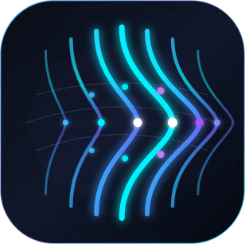
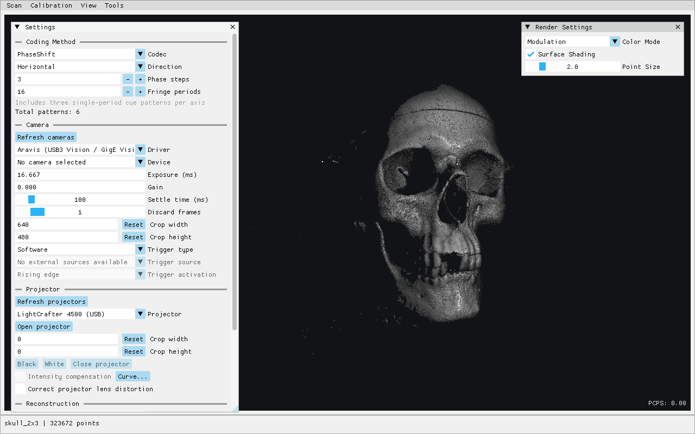

<p align="center"></p>

# SLStudio — Real-Time Structured Light

[](https://github.com/jakobwilm/slstudio/stargazers)
[](https://github.com/jakobwilm/slstudio/actions/workflows/build.yml)
[](https://github.com/sponsors/jakobwilm)

[](https://github.com/jakobwilm/slstudio/releases)
[](https://github.com/jakobwilm/slstudio/releases)
[](https://github.com/jakobwilm/slstudio/releases)

SLStudio is an open-source framework for building a 3D scanner from a camera and a light projector. It combines calibration, pattern projection, image acquisition and point-cloud reconstruction in a desktop application.

SLStudio supports both real-time and offline reconstruction. With suitable hardware synchronization, point-cloud rates of 20 Hz or more are possible; actual performance depends on the camera, projector, pattern sequence and processing. Standard projectors and webcams can also be used at lower rates.



*The skull example reconstructed from six projected patterns.*

## Features

- **Structured-light methods:** phase shifting, heterodyne unwrapping, spatial unwrapping, motion-compensated and other phase-shift variants, plus sparse Gray-code reconstruction.
- **Calibration and reconstruction:** camera/projector geometry, projector intensity compensation, configurable filtering, live point-cloud viewing and PLY/PCD export. 
- **Hardware:** Aravis (USB3 Vision/GigE Vision), libdc1394 (IIDC USB/FireWire), XIMEA xiAPI, FLIR Spinnaker and OpenCV webcams; desktop projector outputs and optional direct LightCrafter 3000/4500 control.
- **Live and offline scanning:** low-latency point clouds, reconstruction of recorded sequences and optional ROS 2 output.

Hardware compatibility and timing depend on the specific camera, projector and setup. See [Hardware](docs/hardware.md) for synchronization and device guidance, and [Structured-light methods](docs/structured-light.md) for an overview of the available methods and their tradeoffs.

## Installation

### Portable packages

The download buttons link to [GitHub Releases](https://github.com/jakobwilm/slstudio/releases). Version tags publish packages and SHA-256 checksums after all CI builds and package checks pass. Branch builds remain available as [Actions artifacts](https://github.com/jakobwilm/slstudio/actions).

| Platform | Package | Notes |
| --- | --- | --- |
| Linux x86-64 | AppImage | Bundles application libraries, Aravis, ROS 2 Jazzy and Fast DDS; requires compatible glibc >= 2.39 and host graphics drivers. |
| macOS | DMG with .app | Drag to Applications. Architecture-specific, ad-hoc signed, not notarized; Gatekeeper may require explicit approval. Right-click -> Open, then see Privacy & Security settings. |
| Windows x64 | ZIP folder | Extract everything and keep the executables, DLLs and bundled MSVC runtime together. |

On Linux, make the AppImage executable with `chmod +x SLStudio-linux-x86_64.AppImage`. If FUSE is unavailable, launch with `APPIMAGE_EXTRACT_AND_RUN=1 ./SLStudio-linux-x86_64.AppImage`. 

Packages omit example datasets and the proprietary XIMEA/Spinnaker SDKs. To get started, download the example_data directory from this repository and try Scan -> Load Sequence.

### Platform feature matrix

**✓** means included in the package or available in a source build, depending on the column. **Optional** means the feature needs additional dependencies or configuration. **X** means not included in the package or not supported on that platform. Availability does not guarantee compatibility with every device.

| Feature | Linux package | Linux source | Windows package | Windows source | macOS package | macOS source |
| --- | --- | --- | --- | --- | --- | --- |
| Desktop GUI, calibration, scanning and point-cloud viewer | ✓ | ✓ | ✓ | ✓ | ✓ | ✓ |
| CLI reconstruction, codecs and PLY/PCD export | ✓ | ✓ | ✓ | ✓ | ✓ | ✓ |
| OpenCV webcam capture | ✓ | ✓ | ✓ | ✓ | ✓ | ✓ |
| Aravis USB3 Vision / GigE Vision cameras | ✓ | Optional | ✓ | Optional | ✓ | Optional |
| libdc1394 IIDC USB / FireWire cameras | X | Optional | X | Optional | X | Optional |
| XIMEA xiAPI cameras | X | Optional | X | Optional | X | Optional |
| FLIR / Teledyne Spinnaker cameras | X | Optional | X | Optional | X | Optional |
| Desktop fullscreen projector output | ✓ | ✓ | ✓ | ✓ | ✓ | ✓ |
| Exclusive projector output | ✓ | Optional | Optional | Optional | Optional | Optional |
| LightCrafter 4500 USB control and pattern upload | ✓ | Optional | ✓ | Optional | ✓ | Optional |
| LightCrafter 3000 network control | ✓ | ✓ | ✓ | ✓ | ✓ | ✓ |
| ROS 2 PointCloud2 publishing | ✓ | Optional | X | Optional | X | Optional |

### Building from source

Requires CMake >= 3.21, a C++17 compiler, OpenCV 4 or 5 and Eigen >= 3.3. The GUI additionally uses GLFW, GLEW, OpenGL 3.3 Core and Dear ImGui, which CMake downloads at a pinned version.

For Ubuntu 24.04 or newer:

```sh
sudo apt install cmake git g++ pkg-config libopencv-dev libeigen3-dev \
  libglfw3-dev libglew-dev libaravis-dev libudev-dev libdrm-dev \
  libwayland-dev wayland-protocols
```

```sh
cmake --preset desktop
cmake --build --preset desktop -j4
ctest --preset desktop
./build/desktop/SLStudio
```

Optional camera backends, ROS 2 output and projector integrations may require additional libraries or manufacturer SDKs. See the [platform-specific build guide](docs/building.md) for details.

## Usage

### Calibrate and scan

1. In **View > Settings...**, select the camera, projector and coding method. Configure exposure and trigger settings for your equipment.
2. Use **Calibration > Geometric Calibration...** to calibrate the camera-projector arrangement. Capture a range of target positions and angles across the field of view, then accept the calibration.
3. Optionally use **Calibration > Intensity Calibration...** to measure projector response and apply intensity compensation.
4. Choose **Single sequence** or **Continuous** in Settings, then select **Scan > Start Scan**. Real-time operation depends on suitable projector-camera synchronization.
5. Save or load recorded sequences with the **Scan** menu, and export reconstructed point clouds as PLY or PCD.

To try reconstruction without a scanner, download `example_data` from the repository and load one of its sequences. Its bundled calibration is for the example setup and will not calibrate your own equipment.

Phase-shifting methods are a good general starting point; they trade pattern count, precision and motion sensitivity. See [Structured-light methods](docs/structured-light.md) for guidance.


### Projection and synchronization

Desktop projectors can use fullscreen output; dedicated LightCrafter 3000 and 4500 projectors support hardware pattern playback. Real-time scanning requires suitable synchronization between projector and camera. See [Hardware](docs/hardware.md) for setup guidance.

On macOS, a green camera privacy indicator may remain visible in the top-right corner of the projector output while a camera is active. This is a system overlay, not a window control; see [Apple's guidance](https://support.apple.com/118449) for hiding privacy indicators on external displays during fullscreen use (not verified with SLStudio's borderless window mode).


### LightCrafter4500

For LightCrafter devices, patterns can be uploaded for hardware playback or streamed over HDMI. See [Hardware](docs/hardware.md) for the setup steps and trigger-circuit notes.

### ROS 2 point clouds

ROS 2 point-cloud publishing is available in supported packages and source builds. Enable **Tools > ROS 2 Output > Publish point clouds**; the default topic is `/slstudio/points`, with frame ID `slstudio_camera_optical_frame`. Set **Metres per calibration unit** to match your calibration units, for example `0.001` for millimetres or `1` for metres.

### Command-line reconstruction

Reconstruct a saved sequence without the GUI:

```sh
./build/core/slstudio-reconstruct calibration.xml sequence-folder output.ply
```

## Scientific references

When using SLStudio in academic work, please consider citing:

- Wilm et al. **SLStudio: Open-Source Framework for Real-Time Structured Light.** IPTA, 2014. [IEEE Xplore](https://ieeexplore.ieee.org/document/7002001).
- Wilm, Jakob, Oline V. Olesen, and Rasmus Larsen. **Accurate and simple calibration of DLP projector systems.** *Emerging Digital Micromirror Device Based Systems and Applications VI*, vol. 8979, SPIE, 2014.
- Wilm, Jakob, et al. **Correction of motion artifacts for real-time structured light.** *Scandinavian Conference on Image Analysis*, Springer, 2015.

## Support and license

Building a scanner requires optics, synchronization and often C++ integration work; not every camera/projector combination is tested. Focused bug reports and pull requests are welcome through [GitHub](https://github.com/jakobwilm/slstudio/issues).

SLStudio is available under [GPLv3](LICENSE), with commercial licensing available from [jakob@viscon.dk](mailto:jakob@viscon.dk).

Dependencies retain their own licenses. See [third-party notices](THIRD_PARTY_NOTICES.md) for the component overview, TI API license terms and the locations of notices in portable packages.
