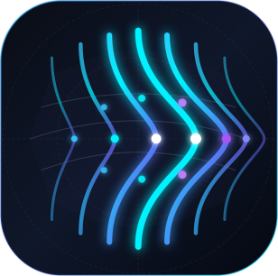
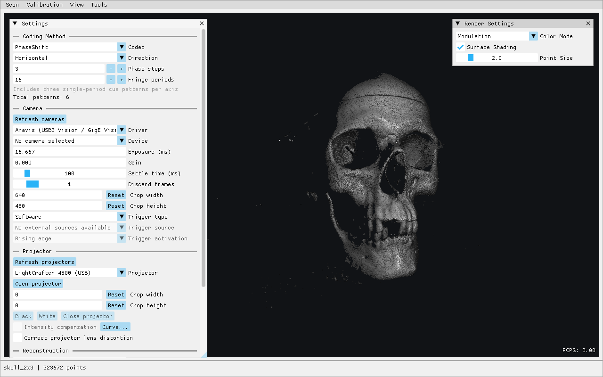
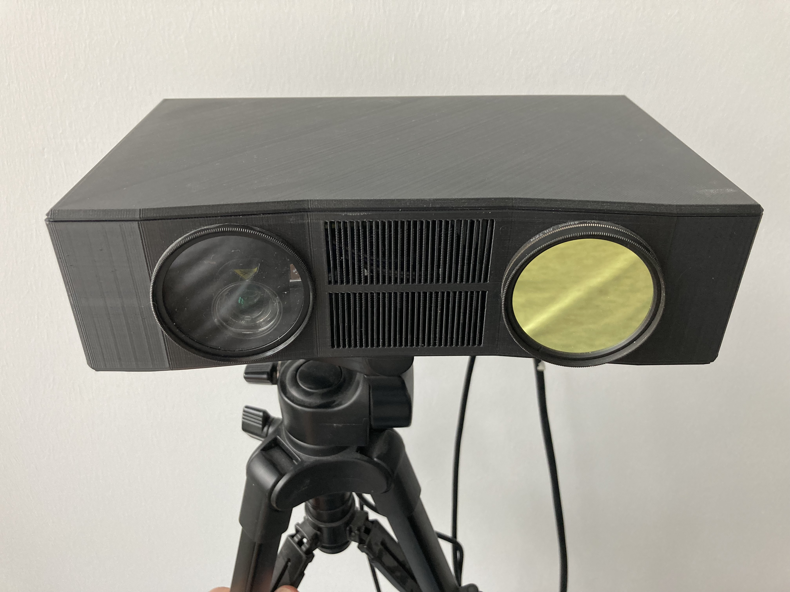

<p align="center"></p>

# SLStudio — Real-Time Structured Light

[](https://github.com/jakobwilm/slstudio/stargazers)
[](https://github.com/jakobwilm/slstudio/actions/workflows/build.yml)

[](https://github.com/jakobwilm/slstudio/releases)
[](https://github.com/jakobwilm/slstudio/releases)
[](https://github.com/jakobwilm/slstudio/releases)

SLStudio is an open-source framework for building a 3D scanner from a camera and a light projector. It combines calibration, pattern projection, image acquisition and point-cloud reconstruction in a desktop application and command-line tool.

Version 2 is a completely reworked codebase with fewer and lighter weight dependencies, and many new features. The difficulty of getting it to work with diverse hardware is also dramatically reduced.

The goal is a flexible research platform with low-latency, real-time reconstruction. Synchronized hardware can achieve point-cloud rates of 20 Hz or more; actual speed depends on the pattern sequence, camera, projector and processing. Ordinary projectors and webcams work at lower rates, without the same timing guarantees.

The point cloud stream can be published as a ROS2 topic. 



*The skull example reconstructed from six projected patterns.*

## Scope and approach

- **Structured-light methods:** phase shifting, heterodyne, spatial unwrapping, motion-compensated and other phase-shift variants, plus sparse Gray-code transition reconstruction.
- **Calibration and reconstruction:** camera/projector geometry, projector intensity compensation, configurable filtering, live point-cloud viewing and PLY/PCD export. Mesh reconstruction is not included.
- **Hardware:** Aravis (USB3 Vision/GigE Vision), XIMEA xiAPI, FLIR Spinnaker and OpenCV webcams; desktop projector outputs and optional direct LightCrafter 3000/4500 control.
- **Live and offline scanning:** low-latency point clouds, reconstruction of recorded sequences and optional ROS 2 output.

Hardware integration remains setup-dependent. Software tests and simulated devices do not establish physical timing, camera compatibility or safe projector flash operation.

## Installation

### Portable packages

The download buttons link to [GitHub Releases](https://github.com/jakobwilm/slstudio/releases). Version tags publish packages and SHA-256 checksums after all CI builds and package checks pass. Alpha, beta and release-candidate tags are published as prereleases. Branch builds remain available as [Actions artifacts](https://github.com/jakobwilm/slstudio/actions).

| Platform | Package | Notes |
| --- | --- | --- |
| Linux x86-64 | AppImage | Bundles application libraries, Aravis, ROS 2 Jazzy and Fast DDS; requires compatible glibc >= 2.39 and host graphics drivers. |
| macOS | DMG with .app | Drag to Applications. Architecture-specific, ad-hoc signed, not notarized; Gatekeeper may require explicit approval. Right-click -> Open, then see Privacy & Security settings. |
| Windows x64 | ZIP folder | Extract everything and keep the executables, DLLs and bundled MSVC runtime together. |

On Linux, make the AppImage executable with `chmod +x SLStudio-linux-x86_64.AppImage`. If FUSE is unavailable, launch with `APPIMAGE_EXTRACT_AND_RUN=1 ./SLStudio-linux-x86_64.AppImage`. No system ROS installation is needed.

Packages omit example datasets and vendor XIMEA/Spinnaker SDKs. Camera/projector permissions still apply. Linux packaging has been exercised in a clean container; Windows and macOS builds still need native validation.

### Platform feature matrix

**✓** means included in the packages configured by the [CI workflow](.github/workflows/build.yml), or available in a source build, depending on the column. It is not a guarantee of a published artifact or tested hardware. **Optional** requires additional dependencies or configuration. **X** means not included in the package or not supported on the platform.

| Feature | Linux package | Linux source | Windows package | Windows source | macOS package | macOS source |
| --- | --- | --- | --- | --- | --- | --- |
| Desktop GUI, calibration, scanning and point-cloud viewer | ✓ | ✓ | ✓ | ✓ | ✓ | ✓ |
| CLI reconstruction, codecs and PLY/PCD export | ✓ | ✓ | ✓ | ✓ | ✓ | ✓ |
| OpenCV webcam capture | ✓ | ✓ | ✓ | ✓ | ✓ | ✓ |
| Aravis USB3 Vision / GigE Vision cameras | ✓ | Optional | ✓ | Optional | ✓ | Optional |
| XIMEA xiAPI cameras | X | Optional | X | Optional | X | Optional |
| FLIR / Teledyne Spinnaker cameras | X | Optional | X | Optional | X | Optional |
| Desktop fullscreen projector output | ✓ | ✓ | ✓ | ✓ | ✓ | ✓ |
| Desktop-independent fullscreen | ✓ | Optional | X | X | X | X |
| LightCrafter 4500 USB control and pattern upload | ✓ | Optional | ✓ | Optional | ✓ | Optional |
| LightCrafter 3000 network control | ✓ | Optional | X | Optional | X | Optional |
| ROS 2 PointCloud2 publishing | ✓ | Optional | X | Optional | X | Optional |

Source-build options are reported during CMake configuration. Aravis needs its shared library and pkg-config; vendor camera backends need compatible manufacturer SDKs for the target OS and architecture. LC4500 uses HIDAPI; enable LC3000 explicitly with `-DSLSTUDIO_PROJECTOR_LC3000=ON`. DRM leasing requires Linux libraries and compositor/display support. ROS 2 source builds require `rclcpp` and `sensor_msgs` in the build environment. Camera access permissions, trigger wiring and physical synchronization remain hardware-dependent on every platform.

### Building from source

Requires CMake >= 3.21, a C++17 compiler, OpenCV 4 and Eigen >= 3.3. The GUI additionally uses GLFW, GLEW, OpenGL 3.3 Core and Dear ImGui, which CMake downloads at a pinned version.

For Ubuntu 24.04 or newer:

```sh
sudo apt install cmake git g++ pkg-config libopencv-dev libeigen3-dev \
  libglfw3-dev libglew-dev libaravis-dev libudev-dev libdrm-dev \
  libwayland-dev wayland-protocols
```

```sh
cmake --preset desktop
cmake --build --preset desktop -j4
ctest --preset desktop
./build/desktop/SLStudio
```

Optional camera SDKs, ROS 2 and projection features are detected automatically. Install the manufacturer's SDK for XIMEA or Spinnaker cameras; Aravis >= 0.8.31 supports compatible USB3 Vision/GigE Vision cameras. The build reports which integrations are available. Use the `core` preset instead of `desktop` for command-line-only use.

For Windows/macOS build dependencies, see the [CI workflow](.github/workflows/build.yml). Linux is the currently validated development platform.

On Windows, install Visual Studio 2022 with **Desktop development with C++**, CMake and Git. From a **Developer PowerShell for VS 2022**, run these commands in the source directory:

```powershell
git clone https://github.com/microsoft/vcpkg.git .vcpkg
$baseline = (Get-Content vcpkg.json -Raw | ConvertFrom-Json).'builtin-baseline'
git -C .vcpkg checkout $baseline
.\.vcpkg\bootstrap-vcpkg.bat -disableMetrics
cmake --preset desktop -G "Visual Studio 17 2022" -A x64 "-DCMAKE_TOOLCHAIN_FILE=$PWD/.vcpkg/scripts/buildsystems/vcpkg.cmake" -DVCPKG_TARGET_TRIPLET=x64-windows
cmake --build --preset desktop --config Release --parallel 4
ctest --preset desktop -C Release
.\build\desktop\Release\SLStudio.exe
```

CMake installs the dependencies listed in [vcpkg.json](vcpkg.json), using the same pinned versions as Windows CI, including Aravis 0.8.36 with USB support. Eigen remains pinned to the compatible 3.x series. The first build compiles dependencies and can take a while; subsequent builds reuse the local installation.

CI runs numerical tests, including geometric calibration, and the general, intensity-calibration and projector GUI smoke tests.

## Usage

### Calibrate and scan

1. Open **View > Settings...** and select the camera, projector and coding method. Start with software triggering; configure exposure, crop and settling for your setup.
2. Open **Calibration > Geometric Calibration...**. Use a circle target (recommended, see pdf file) or checkerboard, enter its physical spacing, and capture varied positions and angles across the field of view. **Accept** saves and activates the calibration; **Load Geometric Calibration...** imports an existing one. [Calibration target generator](https://calib.io/pages/camera-calibration-pattern-generator).
3. Optionally use **Calibration > Intensity Calibration...** to measure projector response and accept a compensation curve. Keep exposure, gain, surface and projection mode fixed during measurement.
4. Choose **Single sequence** or **Continuous** in Settings, then **Scan > Start Scan**. **Stop Scan** preserves the camera preview and last complete sequence.
5. Use **Scan > Save Sequence...** / **Load Sequence...** for recorded frames, and **Export Point Cloud...** for PLY or PCD. Loaded sequences restore coding parameters, while reconstruction uses the active calibration and reconstruction settings.

Scroll to zoom and double-click a point to make it the rotation pivot. **View > Render Settings** controls appearance; **View > Frame sequence** shows the latest complete capture.

Phase-shift methods trade pattern count, precision and motion sensitivity. Something like 2x3 phase shifted patterns with default fringe count is usually a good starting point. Gray code produces sparse measured transitions, not dense stripe interiors. Spatial unwrapping uses fewer patterns, but requires a correct **Center fringe order** assumption: an incorrect value can produce plausible geometry at the wrong depth.

### Projection and synchronization

Desktop fullscreen outputs are available on secondary screens. Linux also supports exclusive DRM leases where the compositor and driver permit them; on X11, detach the projector from the desktop before leasing it. Desktop projection can be affected by other windows and display processing.

For optional X11 DRM leasing, install `libxrandr-dev libx11-xcb-dev libxcb-randr0-dev` and rerun CMake configuration. CMake enables this backend when those packages and the DRM lease prerequisites are available. These additional packages are not required for GLFW fullscreen projection or Wayland leasing.

Real-time scanning requires suitable projector-to-camera trigger wiring. Free-running continuous capture additionally needs frame-associated sequence-start triggers for reliable continous scanning, albeit it can work without. Projectors based on the LightCrafter4500 platform (and the older LightCrafter3000) can use its special projector implementation for hardware patterns (uploaded via USB).




### LightCrafter4500

Patterns can be supplied in two ways:

- **Upload to flash:** open the direct LC4500 projector and use **Upload scan patterns...** or **Upload calibration patterns...**, then play the resident sequence. Starting a scan does not upload patterns; stored patterns must match the selected codec, crop and intensity compensation.
- **Stream over HDMI:** in **Tools > LC4500 Settings...**, select **HDMI patterns (8-bit)** and apply the settings, then select the corresponding HDMI display output in SLStudio. Patterns come from the computer rather than flash; synchronize camera exposures with the projector's trigger outputs.

For cameras with limited I/O, the included [Arduino trigger-circuit sketch](trigger_arduino/rt_lc4500_exptime.ino) combines LightCrafter frame and sequence triggers onto one camera input. See the [circuit notes](trigger_arduino/README.md) for sequence marking and XIMEA GPIO metadata.

Flash programming is experimental and restricted to supported firmware/layouts. Keep power and USB connected throughout; uploads cannot be cancelled.

On Linux, install the LC4500 hidraw permission rule, then reconnect USB:

```sh
sudo install -m 0644 udev/70-slstudio-lc4500.rules /etc/udev/rules.d/
sudo udevadm control --reload-rules
```

### ROS 2 point clouds

The Linux AppImage includes ROS output. For source builds, source your ROS 2 Jazzy environment before building to enable automatic discovery.

Enable **Tools > ROS 2 Output > Publish point clouds**. The default topic is `/slstudio/points`, with frame ID `slstudio_camera_optical_frame`. Set **Metres per calibration unit** to `0.001` for millimetres or `1` for metres. The frame ID labels camera coordinates; no transform is broadcast.

In RViz, use the matching fixed frame and a PointCloud2 display with best-effort reliability. Nodes must share compatible domain/discovery settings. Output is off at startup; publishing errors are reported without stopping scanning.

### Command-line reconstruction

Reconstruct a saved sequence without the GUI:

```sh
./build/core/slstudio-reconstruct calibration.xml sequence-folder output.ply
```

## Scientific references

When using SLStudio in academic work, please consider citing:

- Wilm et al. **SLStudio: Open-Source Framework for Real-Time Structured Light.** IPTA, 2014. [IEEE Xplore](https://ieeexplore.ieee.org/document/7002001).
- Wilm, Jakob, Oline V. Olesen, and Rasmus Larsen. **Accurate and simple calibration of DLP projector systems.** *Emerging Digital Micromirror Device Based Systems and Applications VI*, vol. 8979, SPIE, 2014.
- Wilm, Jakob, et al. **Correction of motion artifacts for real-time structured light.** *Scandinavian Conference on Image Analysis*, Springer, 2015.

## Support and license

Building a scanner requires optics, synchronization and often C++ integration work; not every camera/projector combination is tested. Focused bug reports and pull requests are welcome through [GitHub](https://github.com/jakobwilm/slstudio/issues).

SLStudio is available under [GPLv3](LICENSE), with commercial licensing available from [jakob@viscon.dk](mailto:jakob@viscon.dk).

Dependencies retain their own licenses. See [third-party notices](THIRD_PARTY_NOTICES.md) for the component overview, TI API license terms and the locations of notices in portable packages.
