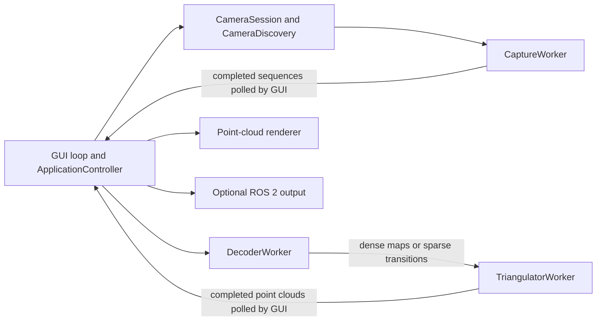

# Architecture

SLStudio separates device acquisition, structured-light decoding, triangulation, and presentation. The desktop application coordinates these stages; the reconstruction algorithms are also usable without the GUI.

## Desktop scan flow

`CameraSession` coordinates the active camera and its preview lifecycle. `CameraDiscovery` performs backend enumeration and trigger-source queries asynchronously. Both are GUI-side coordinators; camera and projector operations are issued through `CaptureWorker`.

`CaptureWorker` owns device instances and calls them on its acquisition thread. Replacing a device releases the old one before opening its replacement. Stopping a scan ends sequence capture without closing the camera; stopping the camera preserves its configuration. The GUI polls command futures and completed frames rather than blocking on device calls.

`DecoderWorker` copies submitted frames and replaces pending work with the newest sequence. Dense decoding produces projector-coordinate maps; Gray-code decoding produces sparse transitions. Its handler submits that result to `TriangulatorWorker`, which also replaces pending work and exposes completed point clouds for GUI polling. Worker errors are surfaced through their polling APIs.

The GUI thread owns ImGui, OpenGL rendering, preview textures, and point-cloud presentation. Desktop projector outputs that require GUI-thread presentation use `ProjectorPresentationController` to acknowledge requests from the acquisition thread. Optional ROS 2 publishing consumes completed point clouds from the GUI update loop.

## Offline reconstruction

`slstudio-reconstruct` loads a saved sequence, then calls the synchronous `DecodeStage` and `TriangulationStage` directly. It shares the core algorithms and calibration data with the desktop application without creating GUI workers or OpenGL resources.

## Validation boundaries

Core tests exercise codecs, calibration, persistence, reconstruction, and point-cloud behavior without the GUI. Acquisition tests verify device-thread ownership, handover, cancellation, and sequence behavior. GUI smoke tests cover the integrated update loop and rendering paths; hardware diagnostics are separate and require connected devices.